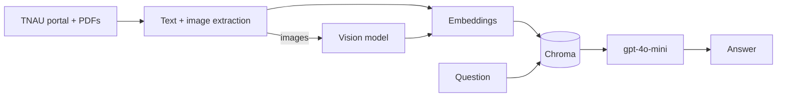

# Multimodal Agriculture Schemes RAG

> First version of the TNAU schemes assistant: multimodal ingestion (text + images from PDFs) and semantic Q&A.

    

## Overview

A multimodal RAG app that crawls the [TNAU AgriTech portal](https://agritech.tnau.ac.in/), extracts text and embedded images from scheme PDFs, describes each image with a vision model, and lets you ask questions over everything in a Streamlit chat.

The improved successor with hybrid search and reranking is [TNAU-Agri-Schemes-AI-Assistant](https://github.com/prasanth-sundararajan/TNAU-Agri-Schemes-AI-Assistant).

## Features

- Portal crawler and scheme parser
- PDF text and image extraction with PyMuPDF
- Image understanding with `gpt-4o-mini` vision
- Chroma vector store with `text-embedding-3-small`
- Streamlit chat with a data-ingestion panel
- Optional LangSmith tracing

## Demo


## How it works



## Tech stack

| Layer | Technology |
|---|---|
| UI | Streamlit |
| Orchestration | LangChain |
| Models | OpenAI `gpt-4o-mini`, `text-embedding-3-small` |
| Vector store | Chroma |
| Ingestion | Requests, BeautifulSoup, PyMuPDF |

## Project structure

```text
.
├── agri_app.py
├── requirements.txt
├── .env.example
└── 2026-10-11 22-48-30.mp4   # demo recording
```

## Getting started

**Prerequisites:** Python 3.10+

```bash
git clone https://github.com/prasanth-sundararajan/multimodel.git
cd multimodel
python -m venv .venv
# Windows: .venv\Scripts\activate    macOS/Linux: source .venv/bin/activate
pip install -r requirements.txt
```

Copy `.env.example` to `.env` and add your keys:

```bash
cp .env.example .env
```

## Usage

```bash
streamlit run agri_app.py
```
Run the ingestion pipeline from the sidebar first, then ask questions in the chat.

## Configuration

| Variable | Required | Description |
|---|---|---|
| `OPENAI_API_KEY` | Yes | OpenAI API key used for chat and embeddings |
| `LANGCHAIN_TRACING_V2` | No | Set to `true` to enable LangSmith tracing |
| `LANGCHAIN_API_KEY` | No | LangSmith API key |

## License

Released under the [MIT License](LICENSE).

## Author

**Prasanth Sundararajan**, Senior SRE and AI Engineer  
[LinkedIn](https://www.linkedin.com/in/prasanth-s-a093a7109/) · [GitHub](https://github.com/prasanth-sundararajan)
